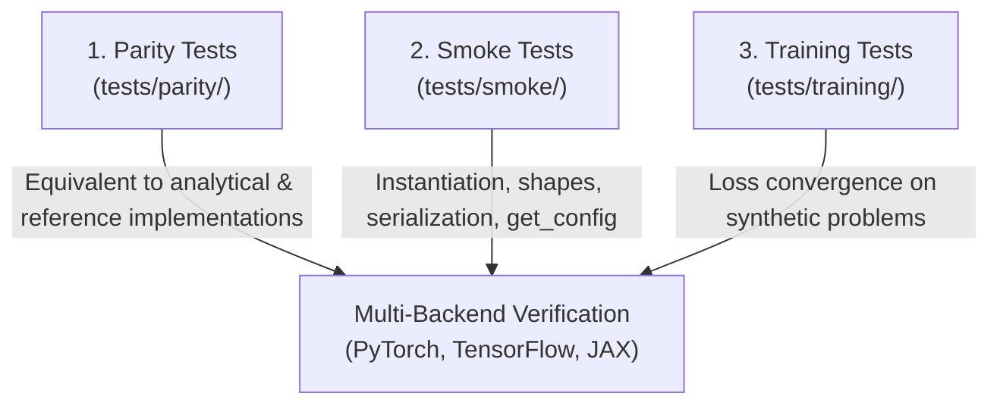

# Testing Philosophy

Testing is central to the design of `keras-sciml`. Scientific machine learning models require validation that exceeds standard deep learning classification suites.

Every component in `keras-sciml` is rigorously tested across three distinct tiers:



---

## 1. Original Implementation Parity (`tests/parity/`)

Where reference scientific implementations exist (e.g. standard FNO spectral multiplication, exact analytical solutions, or finite difference stencils), our implementation is compared directly against the reference to verify mathematical fidelity:

```python
def test_fno_parity():
    ref_out = reference_spectral_conv(x)
    keras_out = keras_spectral_conv(x)
    np.testing.assert_allclose(keras_out, ref_out, rtol=1e-5, atol=1e-6)
```

---

## 2. Generic Smoke Tests (`tests/smoke/`)

Smoke tests ensure that every layer and model conforms to the Keras 3 component lifecycle:
* Object can be instantiated with custom hyperparameters.
* Forward pass handles expected tensor ranks and shapes.
* Layers can be serialized and deserialized (`get_config()` and `from_config()`).
* Gradients can be tracked and computed.

---

## 3. Training Tests (`tests/training/`)

Executing a forward pass is not enough: a scientific model must actually learn.
* Trainable models are trained on small, deterministic synthetic problems for 5–20 epochs on CPU.
* Asserts that training loss decreases strictly below a verification threshold:
  $$\mathcal{L}_{\text{final}} < \alpha \cdot \mathcal{L}_{\text{initial}}$$

---

## 4. Running the Test Suite Across Backends

```bash
# PyTorch backend
KERAS_BACKEND=torch pytest tests/ -q

# TensorFlow backend
KERAS_BACKEND=tensorflow pytest tests/ -q

# JAX backend
KERAS_BACKEND=jax pytest tests/ -q
```

