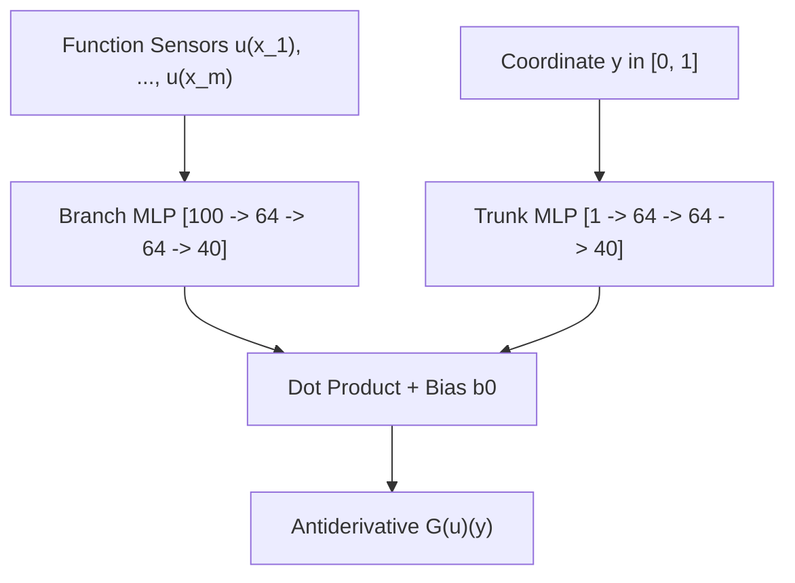

# Antiderivative Operator with DeepONet

This example demonstrates training a Deep Operator Network (DeepONet) to learn the continuous antiderivative operator:
$$G(u)(y) = \int_0^y u(\tau) \, d\tau, \quad y \in [0, 1]$$

Source code: [`examples/deeponet_antiderivative.py`](https://github.com/anas-raza/keras-sciml/blob/main/examples/deeponet_antiderivative.py)

---

## Formulation

* **Branch Net**: Ingests $m=100$ sensor evaluations of smooth functions $u(x_i)$ sampled from a Gaussian Random Field on $[0, 1]$.
* **Trunk Net**: Ingests continuous coordinate query locations $y \in [0, 1]$.
* **Cartesian Product**: Evaluates every function against a grid of $N$ coordinate evaluation points.



---

## Python Implementation

```python
import keras
import numpy as np
from keras_sciml.models import DeepONet

# Branch: sensor encoder
branch = keras.Sequential([
    keras.layers.Dense(64, activation="tanh"),
    keras.layers.Dense(64, activation="tanh"),
    keras.layers.Dense(40),
])

# Trunk: continuous coordinate encoder
trunk = keras.Sequential([
    keras.layers.Dense(64, activation="tanh"),
    keras.layers.Dense(64, activation="tanh"),
    keras.layers.Dense(40),
])

model = DeepONet(
    branch_net=branch,
    trunk_net=trunk,
    mode="cartesian"
)

model.compile(
    optimizer=keras.optimizers.Adam(learning_rate=1e-3),
    loss="mse"
)
```

