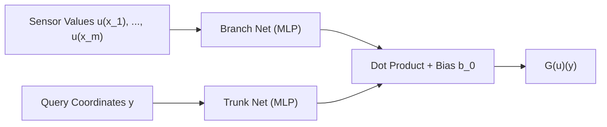

# Neural Operators

Neural operators learn continuous mappings between infinite-dimensional function spaces:
$$G: \mathcal{A} \to \mathcal{U}$$
Unlike standard convolutional or fully-connected neural networks that operate on fixed discretizations, neural operators are **mesh-independent** and **resolution-invariant**: a model trained on a coarse $16 \times 16$ grid can directly evaluate on a high-resolution $256 \times 256$ grid without retraining.

`keras-sciml` provides implementations of the two primary neural operator paradigms:
1. **Fourier Neural Operators (`FNO`)**
2. **Deep Operator Networks (`DeepONet`)**

---

## 1. Fourier Neural Operator (FNO)

The Fourier Neural Operator (Li et al., 2020) parameterizes the integral kernel directly in frequency space using the Fast Fourier Transform (FFT):
$$v_{t+1}(x) = \sigma\left( W v_t(x) + \left(\mathcal{K}(a; \phi) v_t\right)(x) \right)$$
where the non-local kernel integral is computed as:
$$\left(\mathcal{K}(a; \phi) v_t\right)(x) = \mathcal{F}^{-1}\left( R_\phi \cdot \mathcal{F}(v_t) \right)(x)$$

```text
Input a(x) ───► Lifting P ───► [ SpectralConvBlock x Depth ] ───► Projection Q ───► Output u(x)
                                 │                         ▲
                                 └─── Residual Bypass W ───┘
```

### Components

1. **Lifting Layer $P$**: A local linear projection that maps input channel dimension $d_{\text{in}}$ to a high-dimensional latent space $d_v = \text{width}$.
2. **Spectral Convolution Blocks**:
   - `SpectralConv1D` / `SpectralConv2D`: Truncates higher frequency modes beyond `modes` and multiplies lower modes by complex learnable weights $R_\phi$.
   - Spatial linear bypass $W$: Residual connection in spatial domain.
   - Non-linear activation $\sigma$ (`gelu`, `tanh`, `swish`).
3. **Projection Network $Q$**: 2-layer MLP that projects latent representation $d_v$ to target output channels $d_{\text{out}}$.

### Usage: FNO1D & FNO2D

```python
from keras_sciml.models import FNO1D, FNO2D, FNO

# 1D Operator: e.g. Burgers' equation (B, N, 1) -> (B, N, 1)
fno_1d = FNO1D(modes=16, width=64, depth=4, out_channels=1)

# 2D Operator: e.g. Darcy flow (B, H, W, 1) -> (B, H, W, 1)
fno_2d = FNO2D(modes=(12, 12), width=32, depth=4, out_channels=1)

# Generic FNO dispatcher: automatically infers 1D or 2D based on input rank
fno = FNO(modes=12, width=32, depth=4, out_channels=1)
```

---

## 2. Deep Operator Network (DeepONet)

The Deep Operator Network (Lu et al., 2021) is grounded in the Universal Approximation Theorem for Operators (Chen & Chen, 1995). It decomposes the operator evaluation into:
1. **Branch Net**: Encodes the input function $u$ evaluated at $m$ discrete sensor locations $\{x_1, \dots, x_m\}$.
2. **Trunk Net**: Encodes the continuous coordinate location $y$ where the output function is queried.

$$G(u)(y) = \sum_{k=1}^p \text{Branch}(u)_k \cdot \text{Trunk}(y)_k + b_0$$



### Evaluation Modes

* **Cartesian Product**: Evaluates every input function against a shared spatial coordinate grid of $N$ points.
  - Branch inputs: shape `(batch, m_sensors)`
  - Trunk coordinates: shape `(n_points, coord_dim)` or `(batch, n_points, coord_dim)`
  - Output: shape `(batch, n_points)`
* **Pointwise**: Evaluates input function at corresponding paired coordinate locations.
  - Branch inputs: shape `(batch, m_sensors)`
  - Trunk coordinates: shape `(batch, coord_dim)`
  - Output: shape `(batch, 1)`

### Usage: DeepONet

```python
import keras
from keras_sciml.models import DeepONet

# Branch net: takes 100 sensor measurements
branch = keras.Sequential([
    keras.layers.Dense(64, activation="tanh"),
    keras.layers.Dense(64, activation="tanh"),
    keras.layers.Dense(40),  # Latent dimension p=40
])

# Trunk net: takes continuous 1D or 2D query coordinate
trunk = keras.Sequential([
    keras.layers.Dense(64, activation="tanh"),
    keras.layers.Dense(64, activation="tanh"),
    keras.layers.Dense(40),  # Latent dimension p=40
])

model = DeepONet(
    branch_net=branch,
    trunk_net=trunk,
    mode="cartesian"
)
```

