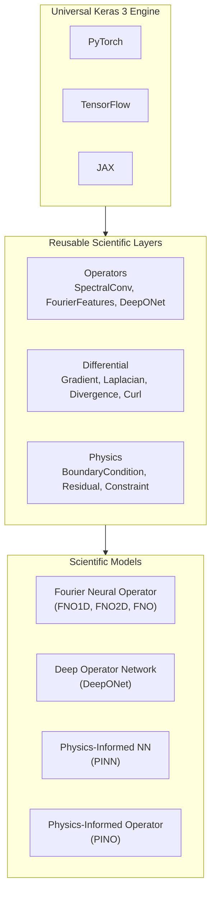

---
hide:
  - navigation
  - toc
---

<div class="sciml-hero">
  <div class="sciml-hero-badge">⚡ Scientific Machine Learning in Keras 3</div>
  <h1>Physics & Neural Operators<br/><span class="sciml-gradient-text">Unified Across Backends</span></h1>
  <p class="sciml-hero-subtitle">
    Differentiable scientific computing, resolution-invariant neural operators, and physics-informed models executing identically across <strong>PyTorch</strong>, <strong>TensorFlow</strong>, and <strong>JAX</strong>.
  </p>
  <div class="sciml-hero-actions">
    <a href="getting-started/quickstart/" class="md-button sciml-btn-primary">Get Started in 5 Min →</a>
    <a href="examples/" class="md-button sciml-btn-secondary">Explore Examples</a>
    <a href="https://github.com/anas-rz/keras-sciml" class="md-button sciml-btn-secondary" target="_blank" rel="noopener">
      GitHub ★
    </a>
  </div>
  <div style="margin-top: 1.5rem; display: flex; justify-content: center; gap: 0.5rem; flex-wrap: wrap;">
    <span class="badge-pill badge-torch">🔥 PyTorch</span>
    <span class="badge-pill badge-tf">⚡ TensorFlow</span>
    <span class="badge-pill badge-jax">🚀 JAX</span>
    <span class="badge-pill badge-success">✓ 217 / 217 Tests Passing</span>
  </div>
</div>

## 🌟 Core Pillars

<div class="sciml-cards">
  <div class="sciml-card">
    <div class="sciml-card-icon">🌊</div>
    <h3>Neural Operators</h3>
    <p>Resolution-invariant operator learning with 1D/2D Fourier Neural Operators (<code>FNO</code>) and Deep Operator Networks (<code>DeepONet</code>). Train on coarse grids, evaluate on fine grids.</p>
    <a href="guides/neural-operators/">Read Guide →</a>
  </div>

  <div class="sciml-card">
    <div class="sciml-card-icon">🧮</div>
    <h3>Differential Layers</h3>
    <p>High-order spatial differential operators (<code>Gradient</code>, <code>Laplacian</code>, <code>Divergence</code>, <code>Curl</code>) with exact boundary handling, compatible with backpropagation across all backends.</p>
    <a href="guides/differential-operators/">Read Guide →</a>
  </div>

  <div class="sciml-card">
    <div class="sciml-card-icon">⚙️</div>
    <h3>Physics-Informed Models</h3>
    <p>Seamlessly integrate physical PDE equations into deep learning with <code>PINN</code> (with Fourier feature embeddings) and <code>PINO</code> (operator learning + PDE residual regularization).</p>
    <a href="guides/physics-informed/">Read Guide →</a>
  </div>

  <div class="sciml-card">
    <div class="sciml-card-icon">📉</div>
    <h3>Scientific Losses</h3>
    <p>Loss functions tailored for physical systems: <code>RelativeL2Loss</code>, Sobolev <code>H1Loss</code>, <code>BoundaryLoss</code>, and integral <code>ConservationLoss</code>.</p>
    <a href="api/losses/">API Reference →</a>
  </div>

  <div class="sciml-card">
    <div class="sciml-card-icon">📦</div>
    <h3>Canonical Datasets</h3>
    <p>Built-in solvers for 1D/2D Poisson, 1D viscous Burgers' equation, 2D Darcy flow, and real NOAA Sea Surface Temperature observational data.</p>
    <a href="guides/datasets/">Browse Datasets →</a>
  </div>

  <div class="sciml-card">
    <div class="sciml-card-icon">🧪</div>
    <h3>Tripartite Testing</h3>
    <p>Every single component is tested across 3 rigorous tiers: original implementation parity, smoke verification, and actual training loss convergence.</p>
    <a href="developer/testing/">Testing Philosophy →</a>
  </div>
</div>

---

## ⚡ Quick Look

=== "Fourier Neural Operator (FNO2D)"

    ```python
    import keras
    from keras_sciml.models import FNO2D
    from keras_sciml.losses import RelativeL2Loss
    from keras_sciml.datasets import DarcyFlowDataset

    # 1. Load canonical Darcy flow dataset (permeability a(x) -> pressure u(x))
    dataset = DarcyFlowDataset(n_samples=500, resolution=32)
    a_train, u_train = dataset.as_tuple()

    # 2. Build resolution-invariant 2D Fourier Neural Operator
    model = FNO2D(
        modes=(12, 12),
        width=32,
        depth=4,
        out_channels=1,
        activation="gelu"
    )

    # 3. Compile with relative L2 loss
    model.compile(
        optimizer=keras.optimizers.Adam(learning_rate=1e-3),
        loss=RelativeL2Loss(),
    )

    # 4. Train across any backend
    model.fit(a_train, u_train, epochs=20, batch_size=16)
    ```

=== "Physics-Informed Neural Network (PINN)"

    ```python
    import keras
    import numpy as np
    from keras_sciml.models import PINN
    from keras_sciml.layers.operators import FourierFeatures

    # Collocation grid: solve -u''(x) = pi^2 * sin(pi * x) on [0, 1]
    x_colloc = np.linspace(0.0, 1.0, 64)[:, None].astype(np.float32)
    y_exact = np.sin(np.pi * x_colloc)

    # PINN with random Fourier feature coordinate embedding
    pinn = PINN(
        hidden_layers=3,
        hidden_units=64,
        out_dim=1,
        activation="tanh",
        fourier_features=FourierFeatures(output_dim=32, scale=2.0)
    )

    pinn.compile(optimizer=keras.optimizers.Adam(1e-3), loss="mse")
    pinn.fit(x_colloc, y_exact, epochs=30, batch_size=32)
    ```

=== "Multi-Backend Execution"

    ```bash
    # Run the exact same codebase on PyTorch, TensorFlow, or JAX:
    export KERAS_BACKEND="torch"        # PyTorch
    python examples/fno_darcy_flow.py

    export KERAS_BACKEND="tensorflow"   # TensorFlow
    python examples/fno_darcy_flow.py

    export KERAS_BACKEND="jax"          # JAX
    python examples/fno_darcy_flow.py
    ```

---

## 🏗️ Architecture Overview


