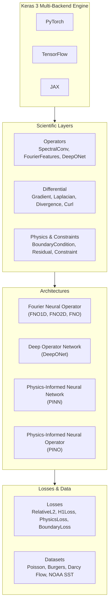

# keras-sciml

<p align="center">
  <strong>Scientific Machine Learning in Keras 3</strong>
</p>

<p align="center">
  <em>Differentiable scientific computing, neural operators, and physics-informed deep learning across PyTorch, TensorFlow, and JAX.</em>
</p>

---

## 🔬 What is keras-sciml?

`keras-sciml` is a scientific machine learning framework built on top of **Keras 3**. It provides reusable layers, canonical PDE datasets, and neural architectures designed for solving scientific problems, differential equations, and operator learning.

By leveraging Keras 3's universal backend engine, models and layers in `keras-sciml` execute seamlessly across **PyTorch**, **TensorFlow**, and **JAX** with zero code modifications.



---

## ✨ Key Features

* **🌊 Neural Operators**: Resolution-invariant operator learning with 1D/2D Fourier Neural Operators (`FNO`) and Deep Operator Networks (`DeepONet`).
* **🧮 Differentiable Differential Operators**: High-order discrete and autograd differential layers (`Gradient`, `Laplacian`, `Divergence`, `Curl`).
* **⚙️ Physics-Informed Learning**: Native support for collocation, boundary conditions (`BoundaryCondition`), and PDE residuals (`Residual`, `PINN`, `PINO`).
* **📉 Scientific Loss Functions**: `RelativeL2Loss`, Sobolev norm `H1Loss`, `BoundaryLoss`, and `ConservationLoss`.
* **📦 Canonical Scientific Datasets**: Fast PDE solvers for 1D/2D Poisson, 1D viscous Burgers' equation, 2D Darcy flow, and real NOAA Sea Surface Temperature observations.
* **🔄 True Multi-Backend Compatibility**: 100% test passing across PyTorch (`KERAS_BACKEND=torch`), TensorFlow (`KERAS_BACKEND=tensorflow`), and JAX (`KERAS_BACKEND=jax`).
* **🧪 Rigorous Tripartite Testing**: Tested at three distinct levels: original implementation parity, shape/serialization smoke tests, and verified learning convergence.

---

## 🚀 Quick Example: 2D Fourier Neural Operator

```python
import keras
from keras_sciml.models import FNO2D
from keras_sciml.losses import RelativeL2Loss
from keras_sciml.datasets import DarcyFlowDataset

# 1. Load canonical Darcy flow dataset (permeability a(x) -> pressure u(x))
dataset = DarcyFlowDataset(n_samples=500, resolution=32)
a_train, u_train = dataset.as_tuple()

# 2. Instantiate resolution-invariant FNO2D
model = FNO2D(
    modes=(12, 12),
    width=32,
    depth=4,
    out_channels=1,
    activation="gelu"
)

# 3. Compile with relative L2 loss
model.compile(
    optimizer=keras.optimizers.Adam(learning_rate=1e-3),
    loss=RelativeL2Loss(),
)

# 4. Train across any backend (PyTorch, TF, JAX)
model.fit(a_train, u_train, epochs=20, batch_size=16)
```

---

## 📚 Documentation Navigation

* **[Installation Guide](getting-started/installation.md)**: Install `keras-sciml` and configure backends.
* **[Quickstart](getting-started/quickstart.md)**: Build your first scientific model in 5 minutes.
* **[Neural Operators Guide](guides/neural-operators.md)**: Theoretical foundations and implementation of FNO & DeepONet.
* **[Physics-Informed Learning](guides/physics-informed.md)**: Solving inverse and forward PDE problems with PINNs and PINOs.
* **[API Reference](api/operators.md)**: Comprehensive, auto-generated API reference for all layers, models, and losses.
* **[Examples](examples/index.md)**: Runnable end-to-end scripts for benchmark physical systems.

